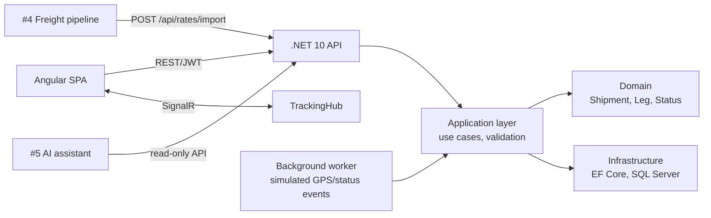

# #1 Logistics Tracking Platform — Plan

**Pitch:** Shipment tracking for a regional freight forwarder: live status updates, role-based dashboards and freight-rate imports.

**Status (2026-10-01):** steps 1–5 built and tested (56 tests green). Remaining: `git init` + push, enable CI, deploy to EC2, record GIF, upgrade to .NET 10.

**Stack:** .NET 8 (→ 10) Web API (Clean Architecture) · EF Core + SQL Server · SignalR · Angular · JWT + roles · xUnit + Testcontainers · Docker · AWS EC2 + Caddy · GitHub Actions

## Architecture (target)

## Steps

### 1. Setup (week 1)
- [x] `.gitignore`, `.editorconfig`, `.env.example`, MIT license
- [ ] `git init` + push to GitHub as `logistics-tracking-platform`
- [x] Solution: `Logistics.Domain`, `Logistics.Application`, `Logistics.Infrastructure`, `Logistics.Api`, `tests/*`
- [x] Angular app in `web/`
- [x] `docker-compose.yml`: api, web, sqlserver
- [x] GitHub Actions: build + test on every PR

### 2. Core domain + API (weeks 1–2)
- [x] Entities: Customer, Shipment, ShipmentLeg, Port, Carrier, StatusEvent, FreightRate, User/Role
- [x] Use cases: create shipment, add status event, search/filter shipments, customer's own shipments
- [x] JWT auth with roles **Admin / Dispatcher / Customer** (policy-based authorization)
- [x] Validation (FluentValidation), global error handling (ProblemDetails), paging
- [x] EF Core migrations + seed from the shared fake data set
- [x] OpenAPI + Scalar UI

### 3. Realtime (week 3)
- [x] `TrackingHub` (SignalR): server-assigned groups (staff / per customer)
- [x] Background worker simulates status/location updates → pushes over SignalR
- [x] Notification when a shipment is delayed

### 4. Angular frontend (weeks 3–4)
- [x] Login, role-based routing/guards
- [x] Dispatcher dashboard: shipment list, filters, status timeline
- [x] Live tracking page (map with Leaflet + live status via SignalR)
- [x] Freight-rate table (filled by #4 later)

### 5. Quality (week 4)
- [x] Unit tests (domain), integration tests against a real SQL Server (LocalDB locally, service container in CI)
- [x] Health checks, structured logging (Serilog)
- [x] Rate-import endpoint `POST /api/rates/import` secured with an API key (for #4)

### 6. Deploy + docs (week 5)
- [ ] Deploy to EC2 with Docker Compose + Caddy (HTTPS), CI/CD from GitHub Actions
- [x] Demo logins for each role (one-click on the login page)
- [ ] Nightly demo-data reset on the server
- [x] README from template, ER diagram, screenshots
- [ ] Tracking GIF (two browsers, ScreenToGif)
- [x] ADRs:
  - `0001-clean-architecture.md`
  - `0002-signalr-over-polling.md`
  - `0003-sql-server-concurrency-and-numbering.md`
  - `0004-jwt-and-role-policies.md`
  - `0005-simulator-uses-real-commands.md`
  - `0006-idempotent-rate-import.md`
