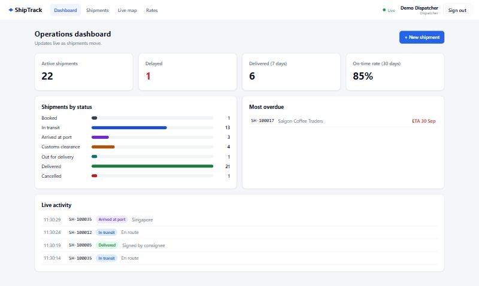
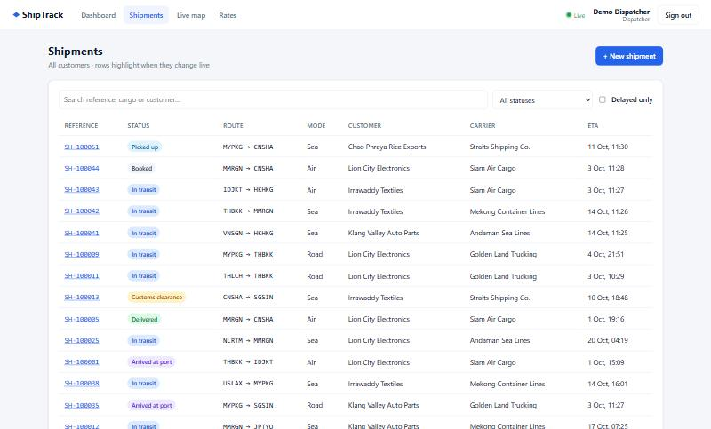
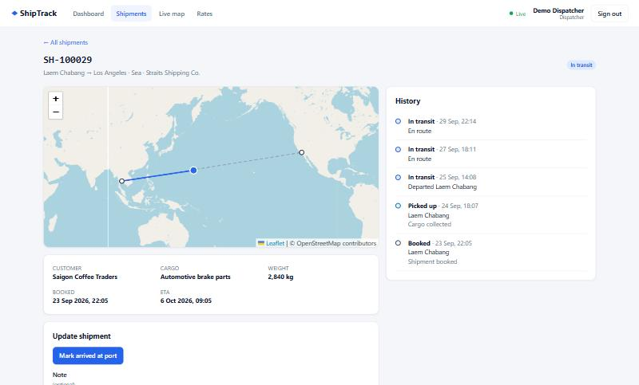
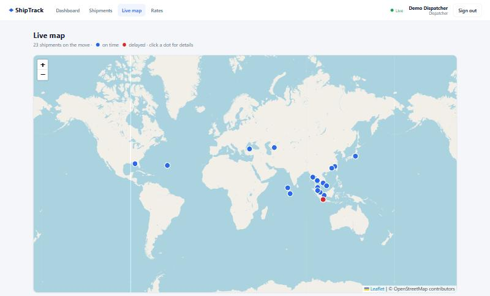
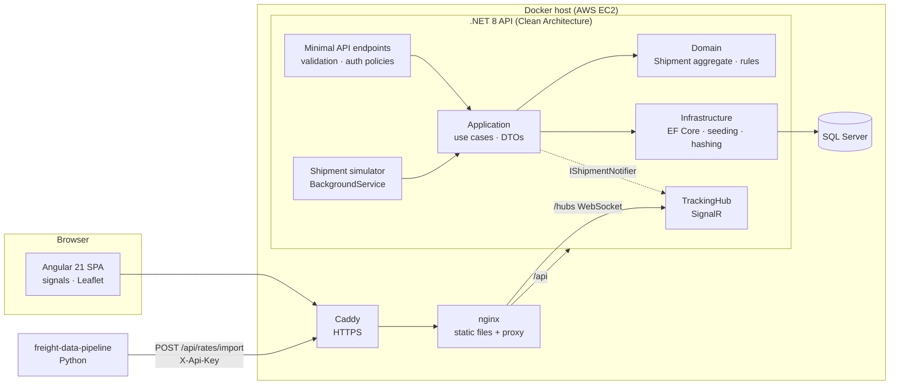
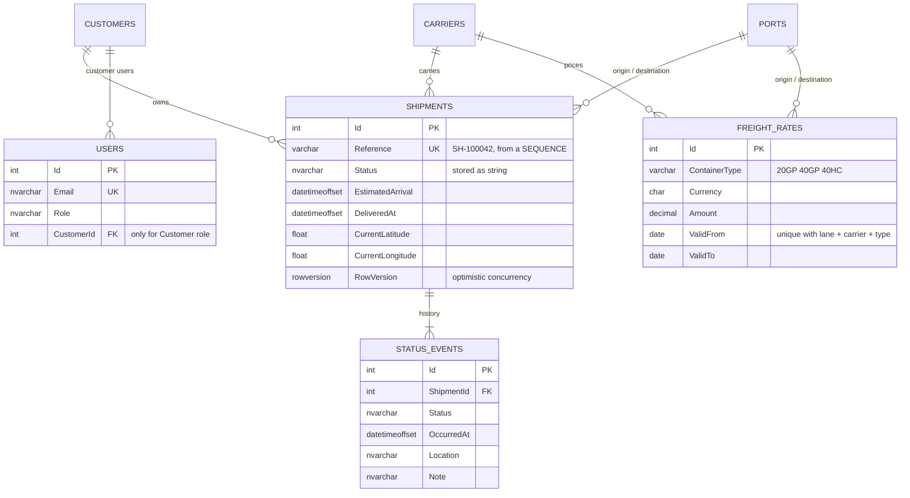

# ShipTrack: Logistics Tracking Platform

> Realtime shipment tracking for a regional freight forwarder. Dispatchers move shipments through a validated lifecycle, customers watch their own cargo move live on a map, and freight rates arrive from a separate data pipeline.

[](https://github.com/arkarlin528/logistics-tracking-platform/actions/workflows/ci.yml)


**Live demo:** _coming soon_ · **Demo login:** one-click demo accounts on the login page · **API docs:** `/docs`



Part of a [connected portfolio](https://github.com/arkarlin528): the **freight-data-pipeline** pushes rates into this API, and the **ai-logistics-assistant** answers questions using it.

## Features

- **Shipment lifecycle as a state machine.** `Booked → Picked up → In transit → Arrived at port → Customs → Out for delivery → Delivered`. Illegal jumps are rejected with a clear 422.
- **Live tracking.** Every status change and position ping is pushed over SignalR, so the dashboard, list, detail page and map all update without polling.
- **Role-based access.** *Admin* and *Dispatcher* see and change everything; a *Customer* sees only their own shipments, enforced in one place on the server.
- **Delay detection.** Overdue shipments are flagged, ETA changes are logged with a reason, and the dashboard shows the on-time rate.
- **Freight rates API.** Idempotent bulk import (API-key protected) for the data pipeline, plus a search endpoint for the UI.
- **Safe under concurrency.** Optimistic locking (SQL Server `rowversion`) and a database `SEQUENCE` for shipment numbers. Both are proven by an integration test that fires parallel requests.
- **A demo that is never still.** A background simulator moves shipments through the *same application commands* a real carrier feed would use.

| Shipments | Shipment detail | Live map |
|---|---|---|
|  |  |  |

## Architecture



Dependencies point inward. **Domain** has no dependencies. **Application** defines the interfaces it needs (`IAppDbContext`, `IShipmentNotifier`, `ITokenService`…), and **Infrastructure** and **Api** implement them. So the realtime push is just another adapter: the use case calls `IShipmentNotifier` and doesn't know that SignalR exists.

### What happens when a dispatcher marks a shipment "Arrived at port"

1. `POST /api/shipments/42/events` → JWT checked → `Staff` policy → FluentValidation filter.
2. `ShipmentCommands.RecordEventAsync` loads the aggregate. `Shipment.RecordEvent` checks the transition table and the time order.
3. `SaveChanges`. The `rowversion` check turns a concurrent edit into **409 Conflict** instead of a silent overwrite.
4. `IShipmentNotifier` → `TrackingHub` sends `ShipmentUpdated` to the `staff` group and to the owning customer's group.
5. Every open page patches its own state: a list row flashes, the map marker moves, and the detail timeline gets the new event.

## Tech stack

| Tech | Why |
|---|---|
| **.NET 8, ASP.NET Core minimal APIs** | Small and fast, with endpoint filters for validation and API keys |
| **EF Core 8 + SQL Server** | `rowversion` concurrency and `SEQUENCE` numbering; matches the enterprise stacks this targets |
| **SignalR** | WebSockets with automatic fallback, groups for per-customer fan-out, and JWT auth |
| **FluentValidation** | Validation rules sit next to the request types and return field-level 400s |
| **Angular 21 (standalone + signals, zoneless)** | Current Angular style: no NgModules and fine-grained change detection |
| **Leaflet + OpenStreetMap** | Free, lightweight maps without an API key |
| **xUnit + WebApplicationFactory** | Integration tests run the real HTTP pipeline against a real SQL Server |
| **Docker Compose, Caddy, GitHub Actions** | One-command local run; automatic HTTPS and push-to-deploy on a single EC2 host |

## Database



Indexes support the actual queries: `(Status, EstimatedArrival)` for the "delayed" filter and dashboard, `(CustomerId, CreatedAt)` for customer lists, and a unique natural key on rates for idempotent upserts.

## API

Interactive docs (Scalar) are at **`/docs`**; the OpenAPI JSON is at `/swagger/v1/swagger.json`.

| Method | Path | Who | Notes |
|---|---|---|---|
| POST | `/api/auth/login` | anyone | Returns a JWT. Rate-limited to 10/min per IP |
| GET | `/api/auth/me` | signed in | |
| GET | `/api/shipments?search=&status=&delayed=&page=&pageSize=` | signed in | Customers get only their own |
| GET | `/api/shipments/{id}` · `/api/shipments/by-reference/{ref}` | signed in | 404 for other customers' shipments |
| POST | `/api/shipments` | Staff | Book a shipment → 201 |
| POST | `/api/shipments/{id}/events` | Staff | Status change / position ping → pushed live. 409 on concurrent edit, 422 on illegal transition |
| PUT | `/api/shipments/{id}/eta` | Staff | ETA change with a reason |
| GET | `/api/dashboard` | Staff | Counts, delays, on-time rate |
| GET | `/api/reference/ports` · `/carriers` · `/customers` | signed in / Staff | |
| GET | `/api/rates?origin=&destination=&on=` | signed in | Cheapest first |
| POST | `/api/rates/import` | `X-Api-Key` | Idempotent bulk upsert; bad rows are reported back and good rows are still saved |
| WS | `/hubs/tracking` | signed in | Server → client `ShipmentUpdated(message)` |
| GET | `/health` | anyone | Includes a database check |

Errors are always [RFC 7807 problem details](https://www.rfc-editor.org/rfc/rfc7807).

## Getting started

### Option A: Docker (everything in containers)

```bash
git clone https://github.com/arkarlin528/logistics-tracking-platform.git
cd logistics-tracking-platform
cp .env.example .env          # then change the secrets
docker compose up --build
```

Open **http://localhost:8080**, then click a demo account. API docs are at http://localhost:8080/docs.
The first start takes about 30 seconds while SQL Server initialises; the API then migrates and seeds by itself.

### Option B: Local development (Windows with LocalDB, or any SQL Server)

```bash
# API: http://localhost:5080/docs (uses appsettings.Development.json → (localdb)\MSSQLLocalDB)
dotnet run --project src/Logistics.Api

# Web: http://localhost:4200 (proxies /api and /hubs to :5080)
cd web && npm install && npm start
```

Requirements: .NET 8 SDK, Node 20.19+ / 22.12+ / 24+, and SQL Server or LocalDB.

## Design decisions

The full write-ups are in [docs/adr](docs/adr/):

- [ADR-0001](docs/adr/0001-clean-architecture.md) **Clean Architecture, without MediatR or repositories.** The layers give testability; DbSet is already a repository.
- [ADR-0002](docs/adr/0002-signalr-over-polling.md) **SignalR over polling, with role-based groups.** The server decides who hears what, from the JWT.
- [ADR-0003](docs/adr/0003-sql-server-concurrency-and-numbering.md) **SQL Server `rowversion` + `SEQUENCE`.** Correct under concurrency without locks.
- [ADR-0004](docs/adr/0004-jwt-and-role-policies.md) **JWT with role policies; one place for customer scoping.** Also covers the trade-offs of the token store and rate limiting.
- [ADR-0005](docs/adr/0005-simulator-uses-real-commands.md) **The demo simulator goes through the real use cases.** The demo can't drift from production behaviour.
- [ADR-0006](docs/adr/0006-idempotent-rate-import.md) **An idempotent, partial-success rate import contract** for the Python pipeline.

## Testing & CI

```bash
dotnet test        # 36 domain tests + 20 API integration tests (needs SQL Server / LocalDB)
```

- **Domain tests:** the lifecycle rules, including a check that every status can still reach *Delivered*, plus the geo helpers.
- **Integration tests:** `WebApplicationFactory` runs the real pipeline against a throwaway SQL Server database that is created, seeded and then dropped. They cover:
  - auth (401/403);
  - customer isolation;
  - validation (400) and illegal transitions (422);
  - **parallel updates → exactly one wins**;
  - idempotent rate import;
  - **SignalR delivery** to staff and the owning customer, and not to other customers.
- **CI (GitHub Actions):**
  - the backend tests against a SQL Server service container;
  - the Angular production build;
  - the Docker image builds;
  - a gitleaks secret scan.

## Deployment

A single EC2 instance runs Docker Compose, with Caddy for automatic HTTPS. GitHub Actions builds the images, pushes them to GHCR and rolls them out over SSH. See [deploy/README.md](deploy/README.md).

## Roadmap

- [ ] Upgrade to .NET 10 LTS. This is one line in `Directory.Build.props` plus package versions; Swashbuckle then gets replaced by the built-in OpenAPI.
- [ ] Frontend tests (Vitest for services, Playwright for one end-to-end flow)
- [ ] Refresh tokens in an httpOnly cookie instead of a long-lived token in localStorage
- [ ] Redis backplane for SignalR when running more than one API instance
- [ ] OpenTelemetry traces and metrics
- [ ] A GIF of two browsers updating live

## License

MIT. All companies, people and shipments in this project are fictional.
